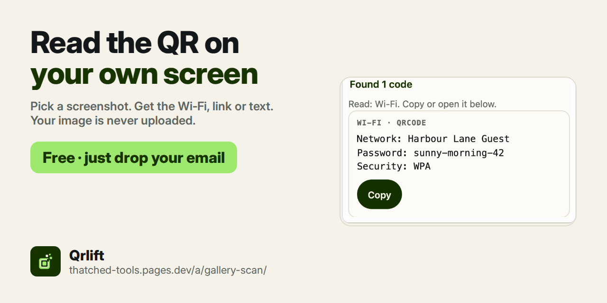

# Qrlift

Qrlift reads a QR code from a screenshot or photo, so you can use a code that is on your own phone or computer screen. It shows what the code holds: a link, Wi-Fi network and password, text, email, phone or barcode number, each with a copy button. Runs in the browser. Live demo: https://thatched-tools.pages.dev/go/gallery-scan/readme

**Read the QR in your gallery.**

## What it does
- Pick, drop or paste a screenshot or photo that has a QR code in it.
- Qrlift finds the code and reads it.
- Links get an Open button; Wi-Fi codes show the network, password and security type.
- Also reads common barcodes (for example EAN-13) and can make a QR code for a link, text or Wi-Fi.

## How to use
1. Open the page and enter your email.
2. Choose the screenshot or photo, or paste it with Ctrl/Cmd + V.
3. Copy the link, password or text you need.

## Free
Qrlift is free. Enter your email once, then use it as much as you like. Your image is read in your browser and is not uploaded.

## About this repo
This repo is the home page for Qrlift. No code is published here.
